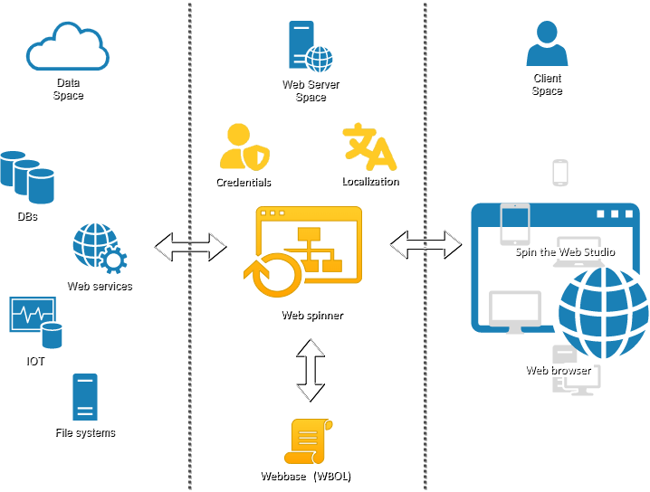

# Spin the Web

Spin the Web is an open-source project for building web portals. It includes WBOL, a language for describing a portal, and Webspinner, a runtime that turns a Webbase into a working site. The project focuses on connecting an organization's content and services with existing systems rather than replacing them.

[Read the project mission](https://github.com/spintheweb/project/blob/main/MISSION.md) and [roadmap](https://github.com/spintheweb/project/blob/main/ROADMAP.md).

---

**Contributions are welcome.** Help with code, design, documentation, testing, or community work is appreciated.

See the [contributing guide](https://github.com/spintheweb/project?tab=contributing-ov-file#), [code of conduct](https://github.com/spintheweb/project?tab=coc-ov-file#), and [governance documents](https://github.com/spintheweb/project/blob/main/GOVERNANCE.md).

---

## Our Workspace

The public project is organized across five repositories:

- **[schemas](https://github.com/spintheweb/schemas)**  
  _WBOL schemas:_ Define the **Webbase Ontology Language (WBOL)**, used to describe portal structure and features.

- **[book](https://github.com/spintheweb/book)**  
  _Documentation:_ A book about WBOL, Webspinner, Studio, and building web portals.

- **[webspinner](https://github.com/spintheweb/webspinner)**  
  _WBOL runtime:_ Reads Webbase models and renders them as working portals, connecting portal elements to data and services.

- **[assistant](https://github.com/spintheweb/assistant)** — _Studio assistant:_ An optional local Ollama assistant for Spin the Web Studio that can suggest limited edits to existing Webbase elements. Developers review changes before saving.

- **[project](https://github.com/spintheweb/project)**  
  _Project information:_ Governance, contributing, and community coordination.

---

## Get Involved

- Visit our website: [spintheweb.org](https://spintheweb.org)
- Visit our labs: [labs.spintheweb.org](https://labs.spintheweb.org)
- Contact us: [info@spintheweb.org](mailto:info@spintheweb.org)
- Learn more in the [Spin the Web book](https://github.com/spintheweb/book).

---

## Selected technologies
- [Node](https://nodejs.org/)
- [Ace Editor](https://ace.c9.io/)
- [Summernote](https://summernote.org/)
- [D3.js](https://d3js.org/)
- [Ollama](https://ollama.com/) (optional, for the local Studio assistant)

*Thanks for taking a look at Spin the Web.*
